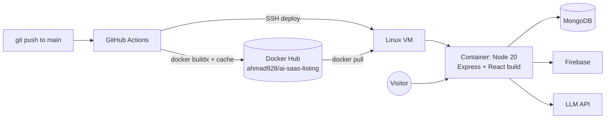

# ToolverAI — AI Tools Directory

**Live:** [toolverai.com](https://toolverai.com)

A full-stack directory for discovering and comparing AI tools — with traffic rankings, side-by-side comparison, curated deals and a prompt library. Built and operated end-to-end: the app, the database, the container image and the deployment pipeline.


## ✨ Features

- **Tool directory** across categories (Coding, Productivity, Image, Video, Audio, Copywriting, Data, Agents)
- **Rankings** by estimated monthly traffic
- **Compare** tools side by side
- **Deals** and a **prompt library**
- **SEO tooling**: SEO validation script and IndexNow submission
- **LLM-powered content** via an OpenAI-compatible API

## 🏗️ Architecture



## 🛠️ Tech stack

| Layer | Tools |
|---|---|
| Frontend | React 19, TypeScript, Vite, Tailwind CSS, Motion, Three.js |
| Backend | Node.js, Express (bundled with esbuild) |
| Data | MongoDB, Firebase Admin |
| AI | OpenAI-compatible SDK |
| DevOps | Docker (multi-stage, healthcheck), GitHub Actions, Docker Hub, SSH deploy |

## 🚢 CI/CD pipeline

Every push to `main` runs [`deploy.yml`](.github/workflows/deploy.yml):

1. **Build & push** — Docker Buildx builds the image with GitHub Actions layer cache and pushes `latest` + a short-SHA tag to Docker Hub.
2. **Deploy** — SSH into the VM, pull the new image, replace the running container (`--restart unless-stopped`), inject secrets as environment variables, prune old images.

The [`Dockerfile`](Dockerfile) is multi-stage: the builder compiles the Vite frontend and bundles the server; the runner ships only production dependencies and the `dist/` output, with a container **HEALTHCHECK** on port 3000.

## 🚀 Run locally

```bash
git clone https://github.com/AhmadMughal-DS/ai-saas-listing.git
cd ai-saas-listing
cp .env.example .env     # fill in your own keys
npm install
npm run dev              # starts the dev server
```

Or with Docker:

```bash
docker build -t toolverai .
docker run -p 3000:3000 --env-file .env toolverai
```

## 📜 Useful scripts

| Command | What it does |
|---|---|
| `npm run build` | Build frontend + bundle server into `dist/` |
| `npm run db:seed` | Seed MongoDB with tool data |
| `npm run validate:seo` | Check pages for SEO issues |
| `npm run indexnow` | Submit URLs to IndexNow |

## 👤 Author

**Muhammad Ahmad** — DevOps & Cloud Engineer · [GitHub](https://github.com/AhmadMughal-DS) · [LinkedIn](https://www.linkedin.com/in/ahmadai)
